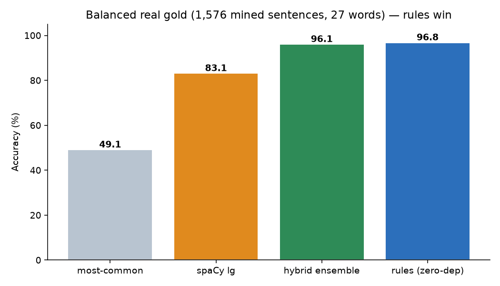

# bifonia

**Pronunciation disambiguation for European-Portuguese heterophonic homographs.** These are words spelled the same way whose pronunciation depends on **meaning**, not just part of speech. bifonia has zero runtime dependencies and uses only the Python standard library.

`sede` means *thirst* (`ˈsedɨ`, closed e) or *headquarters* (`ˈsɛdɨ`, open e). `forma` means *mould* (`ˈfoɾmɐ`) or *shape* (`ˈfɔɾmɐ`). `molho` means *sauce* (`ˈmoʎu`) or *bundle* (`ˈmɔʎu`). A text-to-speech front end that guesses wrong says the wrong word out loud. bifonia picks the right reading, and therefore the right IPA, from context.

```python
from bifonia import tokenize, guess_sense, disambiguate

words = tokenize("Tinha tanta sede que bebi a garrafa toda.")
i = words.index("sede")
guess_sense(words, i)    # 'thirst'
disambiguate(words, i)   # 'ˈsedɨ'   (closed e)

words = tokenize("A sede da empresa fica em Lisboa.")
i = words.index("sede")
disambiguate(words, i)   # 'ˈsɛdɨ'   (open e, same spelling, different word)
```

## Install

```bash
pip install --pre bifonia
```

bifonia publishes alpha releases from the `dev` branch. Use `--pre` to get the API that this README describes. The package has no runtime dependencies.

## Why part-of-speech tagging is not enough

The obvious approach is to tag the part of speech and pick the pronunciation from it. This **does not work when two readings share a POS.** `sede` thirst and seat are both nouns. `forma` mould and shape are both nouns.

A system can look like it solves this problem without solving it. Encyclopedic text (Wikipedia) is **noun-skewed**: one reading dominates and the minority readings barely occur, so a POS tagger that predicts the majority sense scores well on this text. The honest test is a **sense-balanced** set where the minority readings actually appear.

bifonia ships that test: [**`bifonia-pt-homographs-gold`**](https://huggingface.co/datasets/TigreGotico/bifonia-pt-homographs-gold), 2,233 real sentences over 40 words (OpenSubtitles, Wikipedia, web pages), labelled independently of the engine. About 68% of the sentences (1,512) are on words where one part of speech carries two readings.

## Accuracy on the balanced real benchmark

| approach | all (2,233) | POS-ambiguous (1,512) |
|---|:---:|:---:|
| most-common (majority sense) | 57.1% | 59% |
| cue-only (curated wordlists, no POS, no learning) | 60.2% | 64% |
| Yarowsky decision list (trained) | 87.3% | 86% |
| spaCy `pt_core_news_lg` (POS → sense) | 90.6% | 89% |

| approach (continued) | all (2,233) | POS-ambiguous (1,512) |
|---|:---:|:---:|
| logistic regression (numpy, with cue features) | 92.2% | 94% |
| **bifonia rules (zero-dependency)** | **95.2%** | **96%** |
| hybrid ensemble (POS tag and rules) | 96.0% | 97% |



On the POS-ambiguous readings, spaCy reaches 89% and the meaning-keyed rules reach 96%. A tagger has no signal to separate two senses that share a part of speech.

No script in this repository runs the gold-set benchmark, so a fresh clone cannot reproduce this table. [`docs/benchmarks.md`](docs/benchmarks.md) gives the numbers that a command in this repository does reproduce.

## Two engines, one ensemble

| engine | needs a corpus? | how it decides |
|---|---|---|
| **rules** | no | context rules over part-of-speech and meaning cues in `.voc` wordlists |
| **learned** | yes | per-word Naive-Bayes / averaged perceptron over context features |

The rule engine is self-contained and needs no training data, so it fits a low-resource language well. The learned models train from the labelled corpus and serve as a full-roster baseline and a corpus QC engine. `guess_sense` runs a **per-word ensemble**. `scripts/train.py` routes a word to the model only when the model beats the rules on the hand-written behavioural set in `tests/test_sentences.jsonl` and loses none of its cases. In the shipped perceptron model, no word routes to the model, so `guess_sense` gives the rule engine's answer for every word.

A consistent result across this project: **models trained on the corpus do not beat the rules out-of-distribution.** The corpus is rule-labelled, so a model can at best mimic the rules in-distribution and generalizes worse on real text. This holds for Naive-Bayes, the averaged perceptron, and the classic Yarowsky decision list alike. The rules remain the strongest predictor, and an external POS tag can fuse on top:

```python
# hybrid: trust an external tagger only where POS uniquely picks a sense, else rules
guess_sense(words, i, postag="NOUN")
```

The tag decides only where one part of speech maps to exactly one sense. Everywhere else the rules decide. `python scripts/benchmark_ood.py` scores the rules at 88.1% on the encyclopedic wild set (6,640 sentences). No script in this repository scores the hybrid.

## API

```python
from bifonia import (tokenize, is_ambiguous, guess_sense, guess_pos,
                     disambiguate, add_extra_diacritics)

sentence = "Resolveu o problema desta forma simples."
words = tokenize(sentence)
i = words.index("forma")

guess_sense(words, i)                    # 'shape'
disambiguate(words, i)                   # 'ˈfɔɾmɐ'
disambiguate(words, i, sense="mould")    # 'ˈfoɾmɐ'  (override)
add_extra_diacritics(sentence)           # '...desta fórma simples.'  (acute = open vowel)
```

`add_extra_diacritics` rewrites each homograph with a disambiguating diacritic (acute for the open vowel, circumflex for the closed vowel) that a downstream grapheme-to-phoneme stage can read directly.

## Datasets

All datasets are on the Hugging Face Hub. Each record has the fields `word`, `sense`, `pos`, `ipa` and `sentence`, and some sets add more fields:

- [**`bifonia-pt-homographs-gold`**](https://huggingface.co/datasets/TigreGotico/bifonia-pt-homographs-gold): 2,233 real, sense-balanced, independently labelled sentences over 40 words, with a `source` field. This is the honest evaluation set.
- [`bifonia-pt-homographs`](https://huggingface.co/datasets/TigreGotico/bifonia-pt-homographs): the labelled synthetic corpus with stratified train and test splits, with `diacritized` and `diacritized_sentence` fields.
- [`bifonia-pt-homographs-wild`](https://huggingface.co/datasets/TigreGotico/bifonia-pt-homographs-wild): 6,640 encyclopedic (noun-skewed) sentences over 110 words. `scripts/benchmark_ood.py` scores against it.

## Architecture

The design is layered and dependency-free, so a cue behaves the same way in the rules and in the model features:

```
bifonia/__init__.py  public API: tokenize, guess_sense, disambiguate, add_extra_diacritics
bifonia/data.py      loads the roster CSVs and lect overrides (HOMOGRAPHS, POS_SENSES)
bifonia/text.py      strip / accent-fold / proximity-weighted cue scoring   (shared, stdlib)
bifonia/cues.py      SENSE_CUES + FEATURE_CUES: the cue registry             (single source of truth)
bifonia/scoring.py   context rules + one generic cue resolver
bifonia/features.py  language-agnostic features, incl. CUE:<sense> from the registry
bifonia/model.py     loads and scores the learned NB / perceptron JSON models
bifonia/corpus.py    loads bifonia/data/corpus.jsonl into CORPUS
bifonia/data/        roster CSVs, corpus.jsonl, lect_overrides.csv, model JSON
bifonia/locale/<lang>/*.voc   editable context + meaning wordlists
scripts/             training, dataset export and benchmark scripts
scripts/baselines.py a Baseline protocol + baselines, imported as a library (no command line)
```

The meaning cues that disambiguate same-spelling readings live in **one declarative registry** (`bifonia/cues.py`), read by both the rule resolver and the model feature extractor. To add a same-POS word to the cue resolver, add its `.voc` wordlists and one `SENSE_CUES` entry, with no new resolver code. Each word also needs its rows in `bifonia/data/heterophonic_homographs.csv`. Porting to a related language means supplying `.voc` files and, optionally, a corpus, since the algorithm carries no hardcoded Portuguese.

## Coverage

**131 homographs, 297 sense readings** (the rows of `bifonia/data/heterophonic_homographs.csv`). The disambiguation axis is **vowel quality** (open ɔ/ɛ vs closed o/e). The hard core is the same-POS pairs a tagger cannot touch: `sede`, `corte`, `forma`, `molho`, `bola`, `cor`, `lobo`, `polo`, `tola`. Per-word IPA, senses, and diacritized forms are in [`docs/word_references.md`](docs/word_references.md).

## Brazilian Portuguese

bifonia's pronunciations are European Portuguese, taken from Infopédia. A separate Brazilian table is not needed. For 122 of the 131 words, Brazilian Portuguese keeps the same contrast, with the same sense on the same stressed vowel. Many of these words were checked against the Brazilian transcription in Wiktionary, but the repository keeps no list of the checked words. The others follow the general rule: nouns have a closed vowel and the homographic verb forms have an open one, as in *o gosto* [o] and *eu gosto* [ɔ]. One of the 122 words varies: Brazilian speakers say the noun *esmero* with [e] or [ɛ]. bifonia marks it *esmêro*, which is an accepted Brazilian form.

`add_extra_diacritics` marks the stressed-vowel quality with é/ê/ó/ô. The pt-BR lect of the phonemizer builds the other segments, such as final [ɪ], palatalised *t* and *d*, coda *s* and *r*, and vocalised *l*. A mark can also change how the phonemizer reads the rest of the word. In tugaphone 1.4.19a1 with `lang="pt-BR-x-rj"`, *abono* gives [aˈbõnʊ] and *abôno* gives [aˈbõnu].

Nine words differ in Brazil:

- *para* has [a] in both senses. bifonia marks the verb *pára* and leaves the preposition unmarked. This is also correct for Brazil.
- *pelo* has [e] as both contraction and noun. bifonia marks the noun *pêlo* and the verb *pélo* and leaves the contraction unmarked. This is also correct for Brazil.
- *soma*, *abono*, *aceno*, *domo*, *empeno* and *desempeno* have a closed nasal stressed vowel in both senses. Before *m* or *n*, Brazilian Portuguese for the most part has no open mid vowel.
- *tola* is closed in Brazil in the colloquial sense 'judgement, head' (Michaelis). bifonia files that sense and the timber under one `head` sense, and no Brazilian source covers the timber. So pt-BR keeps the European marks for *tola*.

Pass `lang="pt-BR"`, or a sub-lect such as `pt-BR-x-rj`, to `add_extra_diacritics` to apply these differences. *abono*, *aceno*, *domo*, *empeno* and *desempeno* then stay unmarked. *soma* is always *sôma*, because an unmarked *soma* gets an open vowel from the tugalex pt-BR lexicons (`rjx` and `spx`). Every lect tag other than pt-BR and pt-UY keeps the European marks, and `None` means the default. The rows are in `bifonia/data/lect_overrides.csv`, each with its source. For *empeno* and *desempeno* the source is the nasal rule and related verb forms, not a dictionary entry.

`pt-UY` and its sub-lects take the same rows as pt-BR. This is an inference, not a sourced rule: no source states how Uruguayan Portuguese pronounces a stressed mid vowel before a nasal. Its vowel system is that of rural Rio Grande do Sul Portuguese (Rona 1965a, as reported by Meirelles 2006, p. 32; Meirelles 2006, pp. 148-149), and Brazilian Portuguese closes these vowels (Câmara Jr. 1977a, as reported by Lenzi & Brenner 2008, p. 59). The one recorded token, the Spanish place name *Canelones*, has a closed [õ] (Meirelles 2006, p. 143), and contact with Spanish gives no open [ɛ] or [ɔ].

```python
add_extra_diacritics("Ele soma os números.")                # 'Ele sóma os números.'
add_extra_diacritics("Ele soma os números.", lang="pt-BR")  # 'Ele sôma os números.'
```

Do not use the IPA column of `heterophonic_homographs.csv` as a transcription for Brazilian, African or Timorese lects.

## African and Asian lects

The African and Asian lects pt-AO, pt-MZ, pt-CV, pt-GW, pt-ST, pt-TL and pt-MO keep the European marks, and bifonia has no override rows for them. No source found describes the Brazilian closing of a stressed mid vowel before *m* or *n* for any of these lects. For Angola and East Timor the sources point the other way: Luanda Portuguese has open nasal vowels (Cambolo & Osório 2022, pp. 203-205), and Timorese Portuguese does not nasalise a vowel before a nasal consonant (Albuquerque 2010, p. 278) and *ontem* is recorded with an open [ɔ] (Albuquerque 2011, p. 235). This evidence leads to an inference, not a sourced rule: the pt-BR rows do not apply to any of the seven lects. For pt-MZ, pt-CV, pt-GW, pt-ST and pt-MO the inference rests only on the absence of a source. Undolo (2014, pp. 183-185) and Cambolo & Osório (2022, pp. 198-200, with the summary on p. 210) report that Angolan speakers tend to open a stressed /e/ or /o/ where European Portuguese has a closed vowel, as in the noun *desgosto* and in *sede* 'thirst'. Both describe a variable tendency, not a categorical rule, so bifonia keeps the European marks for pt-AO.

## Related projects

- [`TigreGotico/tugaphone`](https://github.com/TigreGotico/tugaphone): a Portuguese G2P for several Lusophone lects. It depends on bifonia and runs `add_extra_diacritics` before it phonemizes.
- [`TigreGotico/tugalex`](https://github.com/TigreGotico/tugalex): the Portuguese pronunciation lexicon that tugaphone reads.
- [`TigreGotico/silabificador`](https://github.com/TigreGotico/silabificador): a rule-based Portuguese syllabifier.

## Documentation

Read the pages in this order. Each page links to the next one.

1. [`docs/usage.md`](docs/usage.md): the full API reference and the scoring signals.
2. [`docs/methodology.md`](docs/methodology.md): corpus construction and the two engines.
3. [`docs/benchmarks.md`](docs/benchmarks.md): every accuracy number, and which ones a command reproduces.
4. [`docs/data_quality.md`](docs/data_quality.md): how corpus labels are checked.
5. [`docs/dataset.md`](docs/dataset.md): corpus schema, counts and splits.
6. [`docs/diacritics_restoration.md`](docs/diacritics_restoration.md): the task framed as diacritics restoration.
7. [`docs/word_references.md`](docs/word_references.md): per-word IPA, senses and diacritized forms.

Runnable examples are in [`examples/`](examples). [`AGENTS.md`](AGENTS.md) gives the repository map, setup and test command for contributors.

## License

Apache-2.0. See [`LICENSE`](LICENSE).
