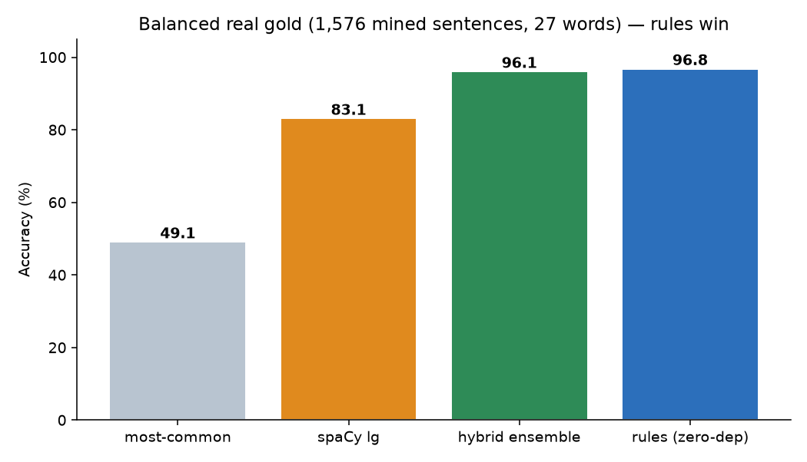
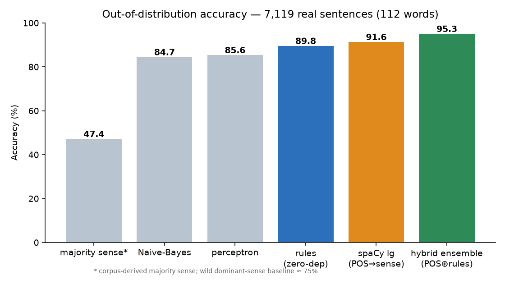
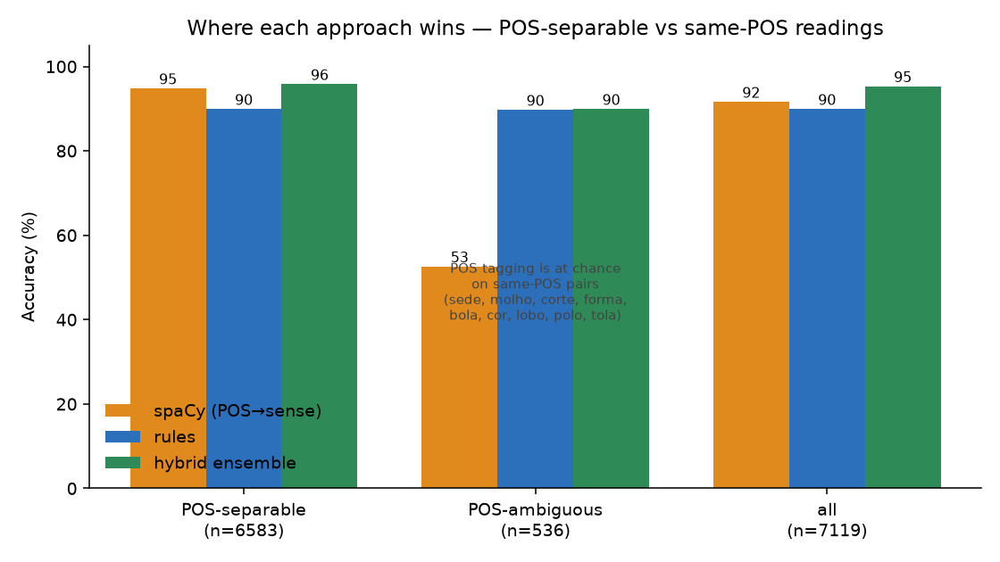
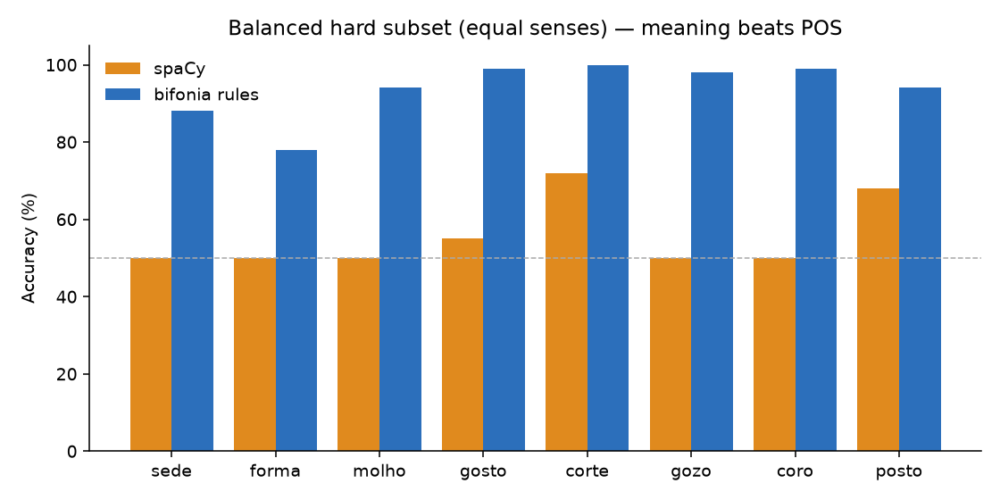
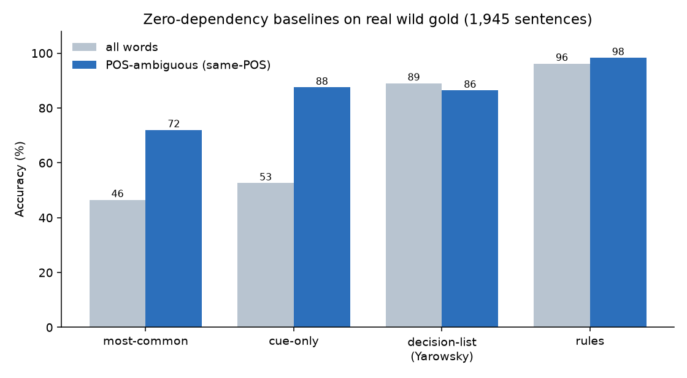

# Benchmarks

Two scripts in `scripts/` measure sense-prediction accuracy. The first sections of this page give the output of a command that you can run from a fresh clone. The last section gives results that no script in this repository produces.

## Out-of-distribution (real Wikipedia sentences)

```bash
pip install huggingface_hub
python scripts/benchmark_ood.py
```

The script downloads `test.jsonl` from [`TigreGotico/bifonia-pt-homographs-wild`](https://huggingface.co/datasets/TigreGotico/bifonia-pt-homographs-wild): **6,640 real sentences over 110 words**. It prints one accuracy per approach and a per-word breakdown.

| approach | OOD accuracy |
|---|---|
| most-common (corpus-derived majority sense) | 53.2% † |
| Naive-Bayes (all roster words) | 84.1% |
| perceptron (all roster words) | 85.7% |

| approach (continued) | OOD accuracy |
|---|---|
| **rules (zero-dependency)** | **88.1%** |
| ensemble (`guess_sense`) | 88.1% |

The ensemble equals the rules, because the shipped perceptron model routes no word to the model.

The script also scores spaCy (`pt_core_news_lg`) and Stanza (`pt`) when those packages and models are installed. Without them, the script prints 0.00% for those two rows.

† `most-common` comes from the bundled corpus and the synthetic train split, so it picks each word's corpus-majority sense. That sense is often not the dominant sense in the wild set.

### The hybrid ensemble: POS tag for POS-separable, rules for same-POS

The dataset is keyed on **(sense, POS) combos**: each meaning slug carries the set of parts of speech it can realize. A word is **POS-separable** when every POS maps to exactly one reading, so a tagger resolves it. A word is **POS-ambiguous** when one POS carries two readings with different IPA (`sede`, `molho`, `corte`, `forma`, `tola`, `bola`, `cor`, `lobo`, `polo`). A tagger cannot separate those readings by construction.

`guess_sense(words, idx, postag=<tag>)` and `disambiguate(words, idx, postag=<tag>)` fuse any external POS tagger with the rules. The tag decides only when it maps to exactly one sense, and the rules decide otherwise. The package stays zero-dependency, and the caller supplies the tag. No script in this repository scores the hybrid. The recorded numbers are in [Results without a reproduction command](#results-without-a-reproduction-command).

### Reading these numbers

- bifonia's rule engine is **offline, zero-dependency, and deterministic**. Unlike a POS tagger, it disambiguates **same-POS lexical pairs** (`sede` thirst/seat, `corte` cut/court, `forma` mould/shape, `molho` sauce/bundle), where a POS tagger can only fall back to the majority sense.
- **The learned per-word models (Naive-Bayes, perceptron) cover every roster word** but trail the rules out-of-distribution (84.1% and 85.7% against 88.1%). The rule engine produced the corpus labels, so a model trained on them can at best mimic the rules in-distribution and generalizes worse on real sentences. The models serve as a full-roster baseline and as the corpus QC engine (see [data_quality.md](data_quality.md)).
- The wild set is encyclopedic and noun-heavy, so one reading dominates most words. A high score on it partly reflects the dominant sense. The balanced sets in the last section test the minority readings.

## Synthetic (in-distribution)

```bash
python scripts/benchmark_tagger.py --no-taggers
python scripts/benchmark_tagger.py --word sede
```

The script scores the train, test and full splits of the synthetic corpus. It fails with a `ValueError` on homograph tokens that carry trailing punctuation ([#43](https://github.com/TigreGotico/bifonia/issues/43)), so this page gives no synthetic number.

## Why POS-tagging isn't the whole story

The disambiguation axis is **vowel quality** (open ɔ/ɛ vs closed o/e). POS predicts it for noun/verb pairs, but the lexical/same-POS pairs need **meaning** cues, which is why bifonia is meaning-keyed.

## Results without a reproduction command

No script in this repository produces the numbers in this section, so a fresh clone cannot reproduce them. Each table names the set that it was measured on.

### Balanced real-gold evaluation

[`TigreGotico/bifonia-pt-homographs-gold`](https://huggingface.co/datasets/TigreGotico/bifonia-pt-homographs-gold) is mined from open sources (OpenSubtitles, news/food/health sites, Wikipedia) and labelled independently of the rules, with every label individually verified. It has 2,233 sentences over 40 words. Unlike the encyclopedic wild set it is **sense-balanced**: 1,512 of its sentences (about 68%) are on POS-ambiguous words, so it is a fair test of disambiguation, not dominant-sense prediction.

| approach | balanced real gold (2,233 sentences, 40 words) | POS-ambiguous subset (n=1,512) |
|---|:---:|:---:|
| most-common | 57.1% | 59% |
| cue-only (wordlists, no POS, no learning) | 60.2% | 64% |
| Yarowsky decision list (trained) | 87.3% | 86% |

| approach (continued) | balanced real gold (2,233 sentences, 40 words) | POS-ambiguous subset (n=1,512) |
|---|:---:|:---:|
| spaCy `pt_core_news_lg` (POS→sense) | 90.6% | 89% |
| logistic regression (numpy, +cues) | 92.2% | 94% |
| **rules (zero-dependency)** | **95.2%** | **96%** |
| **hybrid ensemble (POS tag ⊕ rules)** | **96.0%** | **97%** |



Scoring is by **reading** (open/closed IPA), the G2P-relevant target. On the POS-ambiguous core, the meaning rules hold **96%** and the ensemble **97%**, against spaCy's **89%**. Every learned model (decision list, logistic regression) trails the rules out-of-distribution, the same corpus-circularity seen elsewhere.

### Wild set with spaCy and the hybrid ensemble

These numbers were measured on 7,119 sentences over 112 words. The published wild set has 6,640 sentences over 110 words, so the rules row here does not match the reproducible table above.

| approach | OOD accuracy |
|---|---|
| spaCy `pt_core_news_lg` (POS → sense) | 91.6% |
| rules (zero-dependency) | 89.9% |
| hybrid ensemble (POS tag ⊕ rules) | 95.3% |



| subset | n | spaCy | rules | **ensemble** |
|---|---|---|---|---|
| POS-separable | 6583 | 94.8% | 89.9% | **95.8%** |
| POS-ambiguous | 536 | **52.6%** | 89.7% | **89.9%** |
| **all** | 7119 | 91.6% | 89.9% | **95.3%** |



On that set the tagger is strong on POS-separable readings and near chance on POS-ambiguous ones, and the ensemble takes the better of the two on each subset.

### Sense skew and the balanced hard subset

The wild set is **sense-skewed**: Wikipedia is encyclopedic (noun-heavy), so for most words one reading dominates and minority senses barely occur. A fair test is **balanced** (equal senses per word), on words a POS tagger **cannot** separate (same-POS or POS-unreliable readings):

| approach | balanced hard subset (8 words, n=1280) |
|---|---|
| most-common | 50% |
| spaCy `pt_core_news_lg` (POS→sense) | 59% |
| **bifonia rules** | **94%** |



Per word (rules): `sede` 88, `forma` 78, `molho` 94, `gosto` 99, `corte` 100, `gozo` 98, `coro` 99, `posto` 94. On the same-POS pairs (`sede`, `molho`, `coro`, `gozo`) spaCy is pinned at about 50% (chance), since it has no POS signal to use, while the meaning-keyed rules resolve them.

### Zero-dependency baselines

`scripts/baselines.py` defines the baselines below as classes behind one `Baseline` protocol, with `load_examples` and `score` helpers. It has no command-line entry point. All the baselines except logistic regression are **pure stdlib**. They were fit on the synthetic train split and scored on a real-text set.

| baseline | all words | POS-ambiguous (same-POS) |
|---|---|---|
| most-common (training majority) | 46.5% | 72.0% |
| cue-only (sense-cue registry, no POS, no learning) | 52.6% | 87.5% |
| decision-list (Yarowsky, one-sense-per-collocation) | 89.0% | 86.4% |

| baseline (continued) | all words | POS-ambiguous (same-POS) |
|---|---|---|
| logistic regression (numpy, same features incl. CUE:) | 92.2% | 93.3% |
| **rules (zero-dependency)** | **96.2%** | **98.3%** |



The numpy logistic regression is the strongest *learned* model. The CUE: features lift it well past the decision list, yet it **still trails the rules** by about 3 to 4 points. With the same cues the rules use, a learned linear model gets close but does not beat them on real text, because the corpus it learns from is itself rule-labelled. The sense-cue registry alone reaches 87.5% on the same-POS words, so the curated cues carry most of the signal before any POS reasoning or learning.

---
[← Methodology](methodology.md) · [Home](../README.md) · [Data quality →](data_quality.md)
